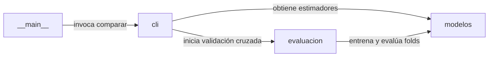

[Leer en español](README.md)

# Comparación de clasificadores y ensambles

Reproducible benchmark comparing single classification models against ensemble methods on real-world and synthetic tabular datasets.

[](https://github.com/ale0009/ensemble-learning-demo/actions/workflows/ci.yml)


## Why this exists

Empirically evaluate whether combining classifiers improves predictive performance over individual models depending on data characteristics.

## Architecture



### Components

| Component | Responsibility |
| --- | --- |
| `modelos` | Instanciación y parametrización de clasificadores individuales (KNN, Regresión Logística, Árbol, Naive Bayes) y ensambles (Voting, Bagging, Random Forest, Gradient Boosting, Stacking). |
| `evaluacion` | Ejecución de validación cruzada estratificada en cinco particiones y cálculo de media y desviación estándar para accuracy y F1 macro. |
| `cli` | Orquestación del benchmarking, renderizado de tablas en consola en formato Markdown y exportación de comparacion.csv y comparacion.png. |
| `__main__` | Punto de entrada de línea de comandos para despachar las instrucciones del módulo CLI. |

## Stack

- Python
- scikit-learn
- pandas
- matplotlib
- tabulate
- pytest
- uv

## Getting Started

### Installation

```bash
uv sync
```

### Testing

```bash
uv run pytest -q
```

### Execution

```bash
uv run python -m ensemble_demo comparar
```

## Results

| Metric | Value | Note |
| --- | --- | --- |
| Breast cancer - Regresión logística (Accuracy media ± desv) | 0.9737 ± 0.0186 | Modelo con mayor accuracy media en el dataset Breast cancer mediante 5-fold cross-validation. |
| Breast cancer - Stacking (Accuracy media ± desv) | 0.9701 ± 0.0133 | Ensamble con mejor equilibrio entre exactitud y baja dispersión en Breast cancer. |
| Sintético - Stacking (Accuracy media ± desv) | 0.8067 ± 0.0357 | Modelo con mejor desempeño global en el dataset sintético generado con make_classification. |
| Wine - Regresión logística (Accuracy media ± desv) | 0.9833 ± 0.0152 | Mejor exactitud media registrada en el dataset Wine. |
| Wine - Voting hard / Stacking (Accuracy media ± desv) | 0.9832 ± 0.0154 / 0.9832 ± 0.0249 | Ensambles con exactitud superior al 98 % en el dataset Wine. |

## Limitations and Roadmap

### Limitations

- Los resultados dependen estrictamente de las semillas aleatorias, hiperparámetros predeterminados y particiones fijadas.
- La evaluación abarca tres conjuntos de datos pequeños y no modela escenarios de alta dimensionalidad o desbalance extremo.
- La desviación estándar entre cinco particiones estratificadas no reemplaza una validación externa con datos independientes.

### Roadmap

- Incorporar optimización de hiperparámetros (tuning) para comparar modelos en sus mejores configuraciones.
- Evaluar comportamiento ante clases fuertemente desbalanceadas utilizando métricas como PR-AUC.
- Incorporar librerías adicionales de boosting (XGBoost, LightGBM).

## Origin

Individual, open-source reimplementation based on an academic team project at Universidad ECCI.

## License

This project is licensed under the terms of the MIT license. See the LICENSE file for details.

Copyright (c) 2026 Mario Alejandro Puerta Alarcón.
