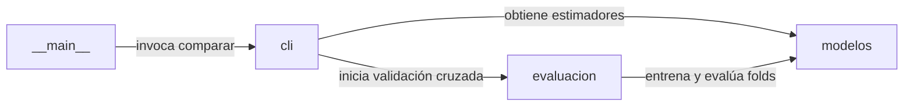

# Arquitectura del Sistema: Comparación de clasificadores y ensambles

## Visión general

Comparación reproducible del rendimiento entre modelos individuales de clasificación y métodos de ensamble sobre conjuntos tabulares reales y sintéticos.

Determinar empíricamente si la combinación de clasificadores mejora la predicción frente a modelos individuales según la naturaleza de los datos.

## Diagrama de arquitectura



## Componentes

| Componente | Responsabilidad |
| --- | --- |
| `modelos` | Instanciación y parametrización de clasificadores individuales (KNN, Regresión Logística, Árbol, Naive Bayes) y ensambles (Voting, Bagging, Random Forest, Gradient Boosting, Stacking). |
| `evaluacion` | Ejecución de validación cruzada estratificada en cinco particiones y cálculo de media y desviación estándar para accuracy y F1 macro. |
| `cli` | Orquestación del benchmarking, renderizado de tablas en consola en formato Markdown y exportación de comparacion.csv y comparacion.png. |
| `__main__` | Punto de entrada de línea de comandos para despachar las instrucciones del módulo CLI. |

## Flujo de datos

1. **__main__** comunica con **cli**: invoca comparar.
2. **cli** comunica con **modelos**: obtiene estimadores.
3. **cli** comunica con **evaluacion**: inicia validación cruzada.
4. **evaluacion** comunica con **modelos**: entrena y evalúa folds.

## Registro de Decisiones de Arquitectura (ADR)

- [ADR-0001: Evaluación con 5-fold Stratified Cross-Validation](adr/0001.md)
- [ADR-0002: Uso exclusivo de datasets integrados y generados sintéticamente](adr/0002.md)
- [ADR-0003: Exportación dual de resultados en consola y archivos de evidencia](adr/0003.md)

## Calidad y pruebas

La verificación técnica del sistema se realiza de forma automatizada mediante la ejecución de:

```bash
uv run pytest -q
```
